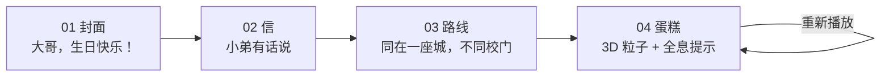

<p align="center">
  
</p>

<h1 align="center">Starry 2329 Birthday Card</h1>

<p align="center">
  一封藏在星空、粉笔字和 3D 粒子蛋糕里的生日祝福。
</p>

<p align="center">
  <a href="https://oyyf-birthday-card.lovable.app"><strong>在线预览</strong></a>
  ·
  <a href="https://github.com/maocat823/starry-2329-birthday-card">GitHub</a>
</p>

<p align="center">
  
  
  
  
  
  
  <a href="https://github.com/maocat823/starry-2329-birthday-card/stargazers">
    
  </a>
</p>

> 做给大哥，也做给所有想认真说一句“生日快乐”的人。

## 项目简介

这是一个**没有数据库、没有登录、只有一个路由**的私人生日贺卡。四页内容在内存里顺序切换：巨大的粉笔标题、一封手写信、一条同城跨校的送达路线，最后是一个会吹蜡烛、会爆炸成文字、还会弹出全息提示的 3D 粒子蛋糕。

项目从“能不能把一张生日贺卡做得像一场小电影”出发：星空底、粉笔字、纸张质感、粒子火焰、金色心形轨迹、深蓝毛玻璃的“宇宙系统提示”，以及一段用 Web Audio 合成的《欢乐颂》音乐盒。它不追求通用模板，只追求把一句生日快乐讲得足够认真。

- **在线预览**：https://starry-2329-birthday-card.lovable.app
- **仓库**：https://github.com/maocat823/starry-2329-birthday-card
- **状态**：个人项目，持续打磨；当前 14 个测试通过

## 四页叙事



| 步骤 | 页面 | 关键内容                                             | 交互             |
| ---- | ---- | ---------------------------------------------------- | ---------------- |
| 01   | 封面 | 两行巨大粉笔字、跨校送达说明                         | 点此继续         |
| 02   | 信   | 手写信笺、三条人物印象（讲义气 / 笑点低 / 跨校认证） | 下一页           |
| 03   | 路线 | 长沙工业学院 → 湖南财经学院，同城跨校送达            | 去看蛋糕         |
| 04   | 蛋糕 | 3D 粒子蛋糕、吹蜡烛、全息提示、祝福纸条              | 拖动、全屏、重播 |

> 四个页面共享同一个 `/` 路由，靠 `BirthdayCard` 里的内存 step 状态切换，不是四个 URL。这样刷新即回到封面，也符合“只给一个人看”的私密感。

## 最后一页：3D 蛋糕与全息提示

### 吹蜡烛之后

| 时间   | 事件                                        |
| ------ | ------------------------------------------- |
| 0.0s   | 点击“许个愿，然后吹蜡烛”，火焰粒子逐渐熄灭  |
| 1.5s   | 蛋糕爆炸成彩色烟花                          |
| 3.5s   | 粒子聚合成“大哥生日快乐”                    |
| 4.5s   | 文字静止 1 秒，金色星光开始画爱心（0.8 秒） |
| 5.3s   | 第 1 个全息提示窗出现                       |
| 10.05s | 第 20 个全息提示窗出现                      |
| 10.2s  | 整组提示开始轻微漂浮                        |
| 12.55s | 停留结束，开始星光淡出                      |
| 13.25s | 淡出完成，回到稳定的粒子文字                |
| 13.8s  | 祝福纸条出现                                |

时间由 `CAKE_TIMELINE` 与 `CAKE_HEARTS` 控制；改数量或间隔后，整条时间线会跟着变化。

### 3D 粒子蛋糕

- 三层蛋糕：底层 50%、中层 30%、顶层 15% 的粒子预算
- 5 根蜡烛，每根有独立跳动的粒子火焰
- 桌面端 15,000 粒子，手机端 9,000 粒子；移动端降低像素比与 bloom 强度
- UnrealBloom 辉光（桌面 1.0 / 手机 0.8，半径 0.5），粒子透明度 0.45，避免过曝
- 拖动环绕查看；爆炸后相机自动回正，把粒子文字摆正
- Canvas 透明，正常页面里透出星空背景；全屏录制时换成近黑 `--cinema` 舞台
- 3D 库（Three.js r128、particle-cake 1.0.0、OrbitControls、后期合成）从固定 CDN 加载，带 SRI，全部在 `useEffect` 里执行，绝不参与 SSR

### 全息提示窗

文字稳定后，20 个“宇宙系统提示”沿爱心轨迹依次出现，每 0.25 秒一个：

- 深蓝/紫色半透明毛玻璃：`backdrop-filter: blur(8px)` + `rgba(30, 40, 80, 0.7)`
- 1px 金色 → 淡紫色渐变边框，金色外发光 `0 0 20px rgba(255, 215, 0, 0.3)`
- 左上/右下科技感金色转角括号
- 顶部亮金色标题：`✨ 宇宙系统提示` / `🔔 星语星愿` 交替，编号 01–20
- 弹窗内容纯白/淡金，右下角“收到”按钮带星空渐变，hover 有细小星光
- 每张卡片 `scale 0.92 → 1` 的 spring（stiffness 300 / damping 20），轻微倾斜、错落叠加
- 全部出现后整体漂浮，停留 2.5 秒，再以透明度 + 轻微缩放 + 模糊像星光一样散开
- 点击“收到”可以单独收起当前弹窗，方便看被压在下面的内容
- 提示层在 3D 画布之上、飘落爱心之下；飘落爱心在蛋糕页被提到前景，但全屏录制时隐藏

文案是“系统报错 × 宇宙浪漫”的反差路线，例如：

> ✨ 系统警告：检测到财院大哥魅力超标！
>
> 💫 Error 404：未找到大哥的缺点。
>
> 🌌 宇宙提示：2329班小弟的祝福正在跨校注入...
>
> 🌟 Bug 修复建议：下次约饭由小弟请客。
>
> 🎂 内存告警：已被大哥的笑声占满。
>
> 🚀 更新完成：新的一岁，请继续做酷酷的自己。

### 祝福纸条与重播

20 个提示淡出后，页面下方出现纸质祝福纸条；它**不会自动滚动页面**，避免把舞台从全息动画里拽走。点“重新播放”会重置蛋糕、重新吹蜡烛、再走一遍完整序列。

## 功能亮点

- **四页一镜到底**：淡入淡出、同路由内存切换、页码圆点
- **星空 + 粉笔视觉**：本地 WebP 星空背景、桌面/手机双尺寸、粉笔字体、纸张信笺、飘落爱心
- **3D 粒子蛋糕**：三层结构、5 根蜡烛、实时火焰、爆炸、粒子文字、拖拽环绕、辉光
- **全息提示序列**：金色星光画心、20 条系统提示、弹簧入场、漂浮、星光淡出
- **全屏录制模式**：手动开启，原生全屏 + iOS 固定层回退，隐藏页码、音乐、飘落爱心
- **音乐盒**：Web Audio 合成《欢乐颂》，无音频文件、无版权曲目；进入蛋糕页时自动播放，右上角可暂停
- **移动优先**：767px 断点、手机粒子预算、移动端星空图、响应式字号与按钮
- **可访问性**：`prefers-reduced-motion` 下关闭自动旋转、飘落爱心和大部分动效
- **纯前端**：无数据库、无 API、无密钥；内容全部静态
- **私人向**：页面 `noindex, nofollow`，不进入搜索引擎

## 技术栈

| 领域   | 技术                                                                                                          |
| ------ | ------------------------------------------------------------------------------------------------------------- |
| 框架   | [TanStack Start](https://tanstack.com/start) 1.168 + TanStack Router                                          |
| UI     | React 19、Tailwind CSS 4、Framer Motion 14、Lucide 图标                                                       |
| 3D     | Three.js r128、particle-cake 1.0.0、OrbitControls、EffectComposer / RenderPass / UnrealBloomPass（CDN + SRI） |
| 音频   | Web Audio API（《欢乐颂》合成音乐盒）                                                                         |
| 构建   | Vite 8 + Nitro（由 `@lovable.dev/vite-tanstack-config` 统一配置，默认 Cloudflare 目标）                       |
| 测试   | Vitest 4 + Testing Library + jsdom                                                                            |
| 包管理 | Bun（仓库带 `bun.lock`）                                                                                      |
| 字体   | Google Fonts：Long Cang / ZCOOL KuaiLe / Noto Sans SC                                                         |

## 快速开始

### 环境要求

- **Bun 1.2+**（推荐，仓库使用 `bun.lock`）
- 或 **Node.js 22.12+**（Vite 8 要求），搭配 npm / pnpm
- 一个支持 WebGL 的现代浏览器
- 首次加载 3D 蛋糕和字体需要联网（CDN + Google Fonts）

### 本地运行

```bash
git clone https://github.com/maocat823/starry-2329-birthday-card.git
cd starry-2329-birthday-card

bun install
bun run dev
```

打开终端输出的地址即可（默认 `http://localhost:8080`）。

使用 npm 的话：

```bash
npm install
npm run dev
```

> 仓库以 Bun 的锁文件为准；npm/pnpm 会生成自己的锁文件，不影响运行。

### 常用脚本

| 命令                                 | 说明                        |
| ------------------------------------ | --------------------------- |
| `bun run dev`                        | 启动开发服务器              |
| `bun run build`                      | 生产构建，产物在 `.output/` |
| `bun run preview`                    | 预览生产构建                |
| `bun run test`                       | 运行 Vitest 测试            |
| `bun run test:watch`                 | 监听模式                    |
| `bun run lint`                       | ESLint                      |
| `bun run format`                     | Prettier 格式化             |
| `bunx tsc --noEmit -p tsconfig.json` | TypeScript 类型检查         |

## 项目结构

```text
.
├── public/
│   ├── backgrounds/
│   │   ├── starry-sky.webp          # 桌面星空 1672×941
│   │   └── starry-sky-mobile.webp   # 手机星空 900×1600
│   ├── apple-touch-icon.png         # 180×180 蛋糕图标
│   ├── favicon-16x16.png
│   ├── favicon-32x32.png
│   └── favicon.ico                  # 16/32/48 多尺寸
├── src/
│   ├── components/birthday/
│   │   ├── BirthdayCard.tsx         # 四页 step 状态、页码、音乐入口
│   │   ├── pages.tsx                # 封面 / 信 / 路线 / 蛋糕四页
│   │   ├── ParticleCakeStage.tsx    # 3D 舞台、全屏、错误回退
│   │   ├── particle-cake.ts         # Three.js + particle-cake 子类
│   │   ├── HeartPopupSequence.tsx   # 20 条全息提示 + 星光画心
│   │   ├── FloatingHearts.tsx       # 飘落粉笔爱心
│   │   ├── ChalkHeart.tsx
│   │   ├── ChalkTitle.tsx
│   │   ├── MusicToggle.tsx
│   │   ├── RemarkCard.tsx
│   │   ├── ParticleField.tsx
│   │   └── HeartBurst.tsx
│   ├── content/
│   │   └── birthday.ts              # 所有文案、全息提示、按钮文字
│   ├── hooks/
│   │   ├── use-media.ts
│   │   └── use-music-player.ts
│   ├── lib/
│   │   ├── cake-config.ts           # 蛋糕结构、时间线、全息提示参数
│   │   ├── cake-palette.ts          # 金色 / 铜色 / 暗红
│   │   ├── heart-popups.ts          # 爱心参数方程与弹窗定位
│   │   ├── hearts.ts
│   │   ├── particles.ts
│   │   ├── birthday-song.ts         # Web Audio 音乐盒
│   │   ├── error-capture.ts
│   │   ├── error-page.ts
│   │   └── utils.ts
│   ├── routes/
│   │   ├── __root.tsx               # HTML shell、字体、背景、favicon
│   │   └── index.tsx                # 唯一路由 /、页面 head
│   ├── test/
│   │   ├── app-routing.test.tsx
│   │   ├── birthday-rules.test.ts
│   │   └── setup.ts
│   ├── router.tsx
│   ├── server.ts
│   ├── start.ts
│   ├── routeTree.gen.ts             # 自动生成，不要手改
│   └── styles.css                   # 星空、粉笔、纸张、全息窗样式
├── vite.config.ts
├── eslint.config.js
├── tsconfig.json
├── package.json
├── bun.lock
└── README.md
```

## 自定义

### 1. 改文案

所有用户能看到的文字都在 **[`src/content/birthday.ts`](src/content/birthday.ts)**：

```ts
export const intro = {
  greetingLead: "大哥，",
  greetingMain: "生日快乐！",
  delivery: "...",
  next: "点此继续",
};

export const cake = {
  // ...
  holoWindows: [{ header: "✨ 宇宙系统提示", message: "..." }],
  holoAck: "收到",
  holoLabel: "全息星光提示",
  message: ["..."],
  footnote: "...",
};
```

- 四页的标题、信、印象卡、路线、按钮、祝福纸条、20 条全息文案都在这里
- 全息提示数量由 `holoWindows.length` 与 `CAKE_HEARTS.count` 共同决定
- 页面的 `<title>` / description / `noindex` 在 [`src/routes/index.tsx`](src/routes/index.tsx)

### 2. 改 3D 蛋糕与时间线

**[`src/lib/cake-config.ts`](src/lib/cake-config.ts)**：

| 配置                    | 作用                                          |
| ----------------------- | --------------------------------------------- |
| `CAKE_TIMELINE`         | 火焰淡出、爆炸、文字成形、纸条出现、重播延时  |
| `CAKE_HEARTS`           | 全息提示数量、画心时长、出现间隔、停留、淡出  |
| `CAKE_STRUCTURE`        | 三层蛋糕、5 根蜡烛、火焰粒子数                |
| `CAKE_BLOOM`            | 桌面/手机 bloom 强度与半径                    |
| `CAKE_ORBIT`            | 拖拽环绕速度、阻尼、极角限制                  |
| `particleCakeOptions()` | 桌面 15,000 / 手机 9,000 粒子，粒子大小与字号 |

爱心路径与弹窗定位在 **[`src/lib/heart-popups.ts`](src/lib/heart-popups.ts)**：经典爱心参数方程采样成 SVG path，再按弹窗数量计算锚点。

### 3. 改配色

- DOM：**[`src/styles.css`](src/styles.css)** 的 CSS 变量 / Tailwind token（星空、粉笔白、金色、纸张、cinema 近黑）
- Canvas：**[`src/lib/cake-palette.ts`](src/lib/cake-palette.ts)** 的 `CAKE_PALETTE`（`#D4AF37` / `#B87333` / `#8B0000`）
- 注意：Canvas 不能读 Tailwind token，粒子颜色使用字面 RGB；DOM 样式尽量走 token

### 4. 换背景和图标

- 背景：替换 `public/backgrounds/starry-sky.webp` 与 `starry-sky-mobile.webp`；断点在 `styles.css` 的 `767px`
- 预加载：`src/routes/__root.tsx` 里按 `media` 预加载桌面/手机背景
- 图标：替换 `public/favicon.ico`、`favicon-16x16.png`、`favicon-32x32.png`、`apple-touch-icon.png`；head 链接同样在 `__root.tsx`
- 当前图标是粉笔白奶油 + 暖金蛋糕 + 三根蜡烛，和站内视觉一致

### 5. 换音乐

**[`src/lib/birthday-song.ts`](src/lib/birthday-song.ts)** 用 Web Audio 合成《欢乐颂》（贝多芬，公有领域），没有音频文件。修改音符、速度、音色即可；播放/暂停状态在 [`src/hooks/use-music-player.ts`](src/hooks/use-music-player.ts)。

### 6. 改页面流程

- `BirthdayCard.tsx` 里的 `TOTAL = 4` 和四个 `step` 分支
- `pages.tsx` 里的 `IntroPage` / `WishPage` / `RoutePage` / `CakePage`
- 如果想把四页拆成四个 URL，需要改成 TanStack Router 的四个 route，并重新处理音乐、翻页动画和刷新状态；当前实现刻意保持单路由

### 7. 3D 依赖与字体

3D 库从 CDN 加载（带 SRI），不在 npm 依赖里。断网或 CDN 被墙时，蛋糕舞台会显示错误提示，其余页面正常。要离线部署，把相关脚本下载到 `public/vendor/`，改 `particle-cake.ts` 里的 URL 与 integrity，并确认同源可访问。

字体来自 Google Fonts；离线时回退到系统字体。需要完全离线可自托管字体并改 `__root.tsx` 的 stylesheet。

### 8. 不要改生成文件

`src/routeTree.gen.ts` 由 TanStack Router 自动生成；改路由后重新构建即可，不要手写。

## 部署

- **当前线上版本**：https://starry-2329-birthday-card.lovable.app （Lovable 托管）
- **本地生产构建**：

```bash
bun run build
bun run preview
```

构建由 TanStack Start + Nitro 完成，产物在 `.output/`；`vite.config.ts` 使用 `@lovable.dev/vite-tanstack-config`，默认 Nitro 目标是 Cloudflare。可以部署到 Cloudflare Workers，或任何支持 Nitro 的 Node/边缘环境。

项目**没有数据库、没有服务端 API、没有密钥**，不需要配置环境变量。页面自带 `noindex, nofollow`，适合私人链接分享。

## 测试

```bash
bun run test
bun run lint
bunx tsc --noEmit -p tsconfig.json
```

当前 **14 个测试**，主要覆盖：

- 页面路由与 head
- 爱心数量、蛋糕页透明度
- 三层蛋糕结构、5 根蜡烛、火焰粒子预算
- bloom 参数、粒子透明度、金色/铜色/暗红三个色锚
- 桌面/手机粒子数量
- 20 条全息文案与 `CAKE_HEARTS.count` 一致
- 祝福纸条晚于全息序列结束

3D 渲染与全息动画依赖浏览器能力，没有做端到端截图测试；本地预览是最直接的验收方式。

## 常见问题

**3D 蛋糕没出来？**
先确认网络能访问 `cdnjs.cloudflare.com` 与 `unpkg.com`。这些 CDN 脚本都带 SRI，CDN 被拦截或返回内容变化时浏览器会拒绝执行；舞台会显示错误文案，其他页面不受影响。

**音乐没有自动播放？**
浏览器要求用户手势后才能启动 AudioContext。当前实现是在最后一次“下一页”点击时播放，进入蛋糕页后自动响；如果被浏览器策略拦住，点右上角音乐按钮即可。

**全屏怎么开？**
右上角“全屏”按钮手动开启。原生全屏在 iOS 上不可用时会自动退化为固定层；`Esc` 或按钮退出。全屏会隐藏页码、音乐和飘落爱心，只留蛋糕、粒子文字和全息提示。

**为什么四个页面不是四个 URL？**
这是刻意的：整张卡是一个顺序叙事，刷新回到封面，分享一个链接即可。要拆成多页，参考上面的“改页面流程”。

**手机上有点卡？**
3D 已经用 9,000 粒子、降低 bloom 和像素比；如果仍然掉帧，可以在 `cake-config.ts` 继续下调 `particleCount`，或在 `CAKE_HEARTS` 减少全息窗数量。`prefers-reduced-motion` 下会自动关闭自动旋转和部分动效。

**想 fork 成自己的贺卡？**
改 `src/content/birthday.ts` 和 `src/routes/index.tsx` 的标题/描述，替换称呼、学校、日期与 20 条全息文案；再换背景、图标和音乐。公开部署前想清楚是否保留 `noindex`，以及是否要把私人信息从 git 历史里清掉。

## 致谢

- [TanStack Start](https://tanstack.com/start) / [TanStack Router](https://tanstack.com/router)
- [React](https://react.dev)、[Vite](https://vite.dev)、[Tailwind CSS](https://tailwindcss.com)
- [Framer Motion](https://www.framer.com/motion/)
- [Three.js](https://threejs.org)、[particle-cake](https://www.npmjs.com/package/particle-cake)
- Google Fonts：Long Cang、ZCOOL KuaiLe、Noto Sans SC
- 贝多芬《欢乐颂》（公有领域）
- 以及所有在 2329 班一起笑过的人

## License

这个仓库目前**没有附带 LICENSE 文件**。代码可以阅读、学习；如果要转载、复用或二次分发，请先联系作者，并把其中的称呼、学校、日期等个人信息替换掉。

---

<p align="center">
  Made with ♥ by <a href="https://github.com/maocat823">maocat823</a>
  <br />
  如果这份贺卡也让你想起某个朋友，欢迎点个 Star。
</p>
